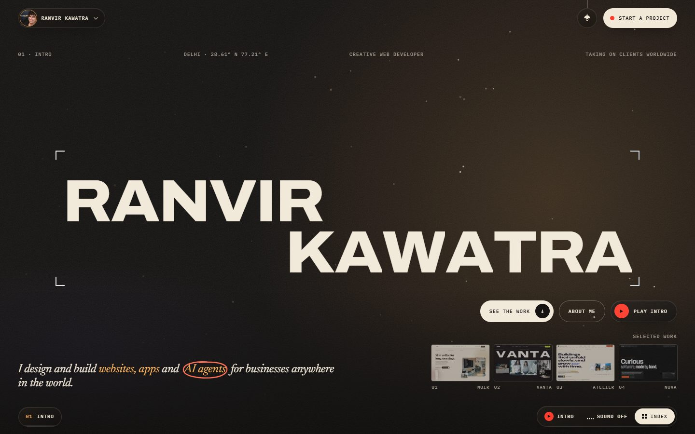
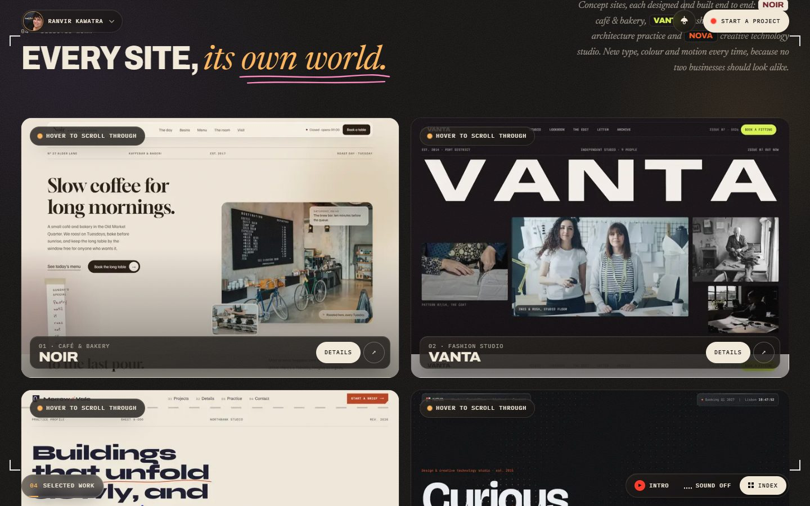
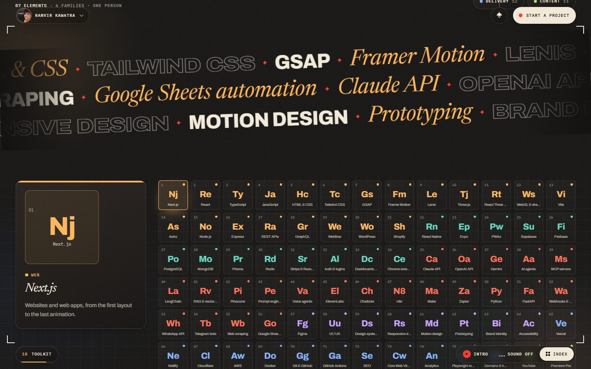
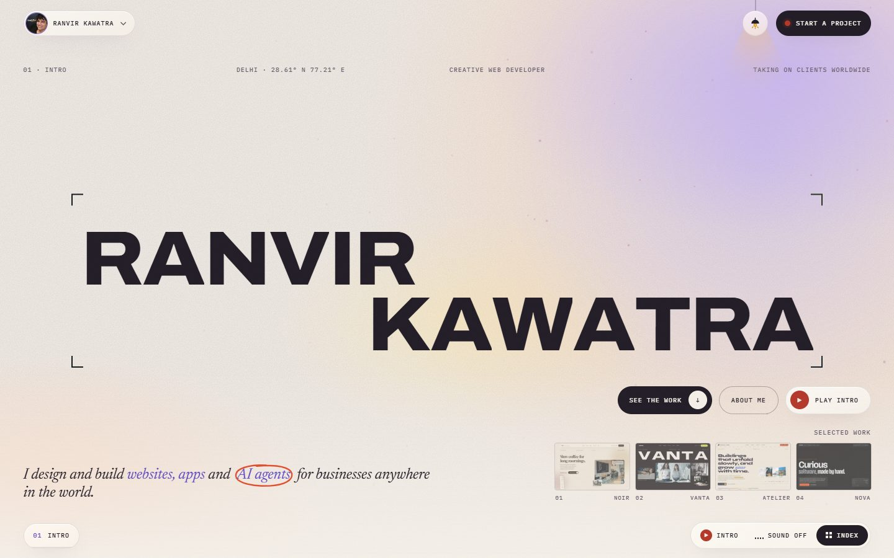
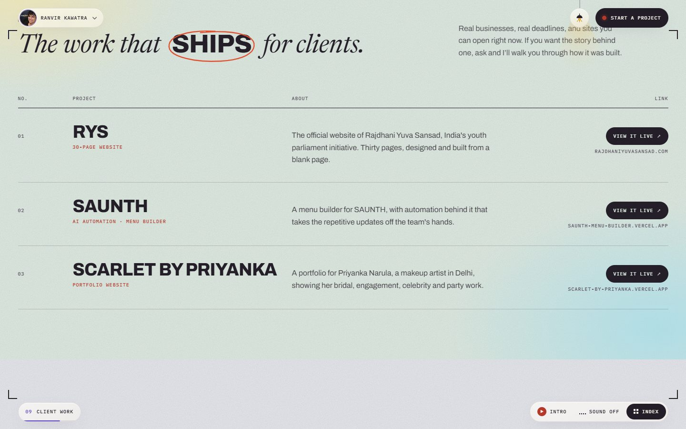
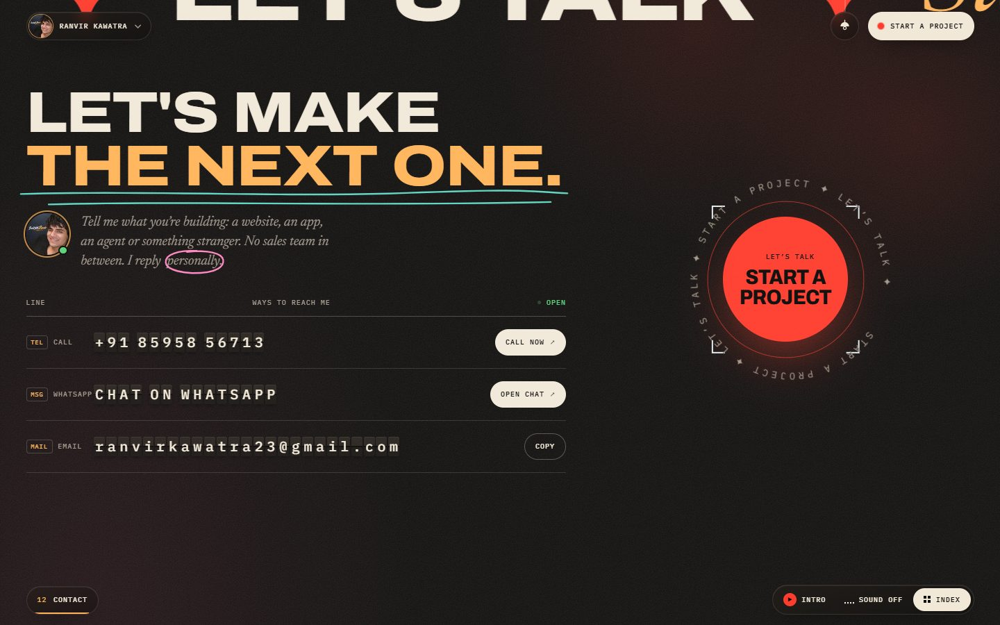
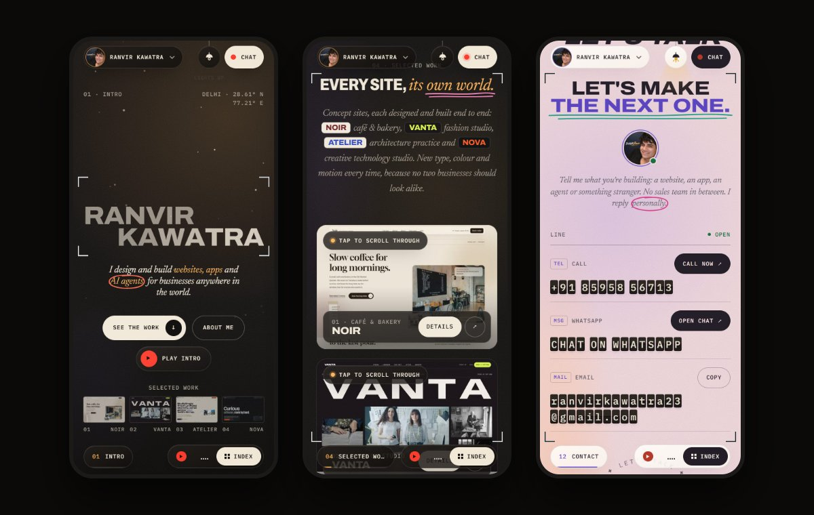

<div align="center">

# Ranvir Kawatra

**Creative web developer in Delhi. I design and build websites, web apps, AI automations and AI agents for businesses around the world.**

This is my portfolio: one page, told like a short film.

[**Open the live site**](https://buildwithranvir.vercel.app) &nbsp;·&nbsp; [Instagram](https://www.instagram.com/buildwithranvir/) &nbsp;·&nbsp; [YouTube](https://www.youtube.com/@buildwithranvir) &nbsp;·&nbsp; [LinkedIn](https://www.linkedin.com/in/ranvir-kawatra-550337420/)

<br>



<br>


</div>

---

## The idea

Most portfolios are a grid of thumbnails. I wanted mine to feel like the work I make, so the page plays like a film. There is an opening title sequence, then twelve scenes that end in a closing credit roll, and a light switch that changes the lighting of the whole set.

Everything on it is real: the sites in the work section are live and working, the client projects link to the actual websites, and the contact section sends you straight to a message with me.

## Screens

<table>
  <tr>
    <td width="50%"></td>
    <td width="50%"></td>
  </tr>
  <tr>
    <td align="center"><sub><b>Selected work.</b> Each card scrolls through a real screenshot of its site and links to the live one.</sub></td>
    <td align="center"><sub><b>Toolkit.</b> 87 tools set out as a periodic table, grouped by family.</sub></td>
  </tr>
  <tr>
    <td width="50%"></td>
    <td width="50%"></td>
  </tr>
  <tr>
    <td align="center"><sub><b>Light mode.</b> A lamp in the corner switches the lighting for the whole page.</sub></td>
    <td align="center"><sub><b>Client work.</b> Real projects, each one linked to the live site.</sub></td>
  </tr>
</table>



<sub><b>Contact.</b> The ways to reach me are set on a split-flap departure board, and the round button opens a chat.</sub>

### On a phone



The site is designed phone first. Every hover effect has a touch version: previews scroll on tap, the toolkit highlights on tap, and the social marks light up by themselves as they arrive.

---

## What is on the page

| Scene | What it does |
| --- | --- |
| **Opening film** | About ten seconds of titles over the real sites. It plays once per browser session, can be skipped at any moment (button, Esc, Enter or Space) and replayed from the menu. The score is synthesised in the browser, so there are no audio files, and sound only starts after a click. |
| **Intro** | My name set large, with a focus pull: letters near your pointer sharpen and widen. On touch screens the focus sweeps along the name on its own. |
| **About** | A portrait on a single frame of film, the story in three short paragraphs, and a few plain facts. |
| **Services** | Websites, web apps, AI automations, AI agents, and anything else technical, printed as frames on a film strip. A swipeable strip on phones. |
| **Selected work** | Concept sites for imaginary businesses (see below). Each has its own scene with its own layout, a tour of five real screens, and a project view with a gallery and a live-site tab. |
| **Client work** | RYS, SAUNTH and Scarlet by Priyanka, each linked to the live site. |
| **Toolkit** | 87 tools as a periodic table in six colour-coded families. Pick a family and its tiles fly to the front. |
| **Process** | Six principles I build by, set on a quiet page. |
| **Contact** | A split-flap board for phone, WhatsApp and email, a three-tap brief builder that writes the WhatsApp message for you, Delhi's local time, and a closing credit roll. |

Around the page: a menu on my name (jump anywhere, call, copy my email, replay the intro), an index of every scene, a reading-progress bar, a sound switch, and a skip link for keyboard visitors.

### Light and dark

Dark is the default. The lamp in the top bar switches the page to a daylight version with pastel colour washes, and a flood of light crosses the screen as the lighting changes. Hand-drawn pencil marks underline and circle a few key words in both modes. The choice is remembered in the browser. The opening film and the concept-site scenes stay dark by design.

### Built to stay smooth

- Motion uses transforms and opacity, so it runs on the compositor and stays even on phones.
- No blur over scrolling content, no sections that pin and hold the page, and no per-frame text layout.
- Looping animations pause when they leave the screen.
- `prefers-reduced-motion` is respected: smooth scrolling, parallax and the film all switch to calm versions.
- Images are optimised through `next/image`, with blur placeholders on the big screenshots.

---

## The concept sites

The work section presents concept websites I designed and built end to end. NOIR, VANTA, ATELIER and NOVA are fictional brands. Their names, prices and testimonials are invented, and their forms send nothing. Each one has its own type, colour and motion on purpose.

| Folder | Site | Industry | Live |
| --- | --- | --- | --- |
| [`noir/`](noir) | **NOIR** | Café and bakery, told like a printed menu | [noir-green-psi.vercel.app](https://noir-green-psi.vercel.app) |
| [`vanta/`](vanta) | **VANTA** | Fashion studio, led by its people | [vanta-chi-two.vercel.app](https://vanta-chi-two.vercel.app) |
| [`atelier/`](atelier) | **ATELIER** | Architecture practice, built like a folded card model | [atelier-pi-beige.vercel.app](https://atelier-pi-beige.vercel.app) |
| [`nova/`](nova) | **NOVA** | Creative technology studio, built like an instrument | [nova-phi-blue.vercel.app](https://nova-phi-blue.vercel.app) |

Photography in the concept sites is from [Unsplash](https://unsplash.com), used under the [Unsplash License](https://unsplash.com/license).

---

## Tech

| | |
| --- | --- |
| **Framework** | Next.js 16 (App Router), React 19, TypeScript |
| **Styling** | Tailwind CSS 4 with design tokens in `@theme`, two lighting themes on `html[data-theme]` |
| **Motion** | GSAP 3 (ScrollTrigger, SplitText, Flip, ScrambleText), Lenis for smooth scrolling, Motion for menus and the project view |
| **Type** | Archivo (the width axis gives the film-credit look), Newsreader italic for the voice, IBM Plex Mono for the camera readouts, all through `next/font` |
| **Sound** | Web Audio, synthesised in the browser |
| **Hosting** | Vercel, one project per folder, deployed from this repository |

## Project structure

```
.
├── showcase/              the portfolio (Next.js app)
│   ├── app/               layout, page, global styles, share image
│   ├── components/
│   │   ├── scenes/        one file per section of the page
│   │   ├── cine/          the frame around the page: intro film, menus, light switch
│   │   ├── motion/        smooth scrolling and the pencil-mark drawing
│   │   └── ui/            small shared pieces
│   ├── lib/               site.ts (all copy and data), theme, sound, scroll helpers
│   └── public/            portrait and the preview screenshots
├── noir/ vanta/ atelier/ nova/    the concept sites, each its own Next.js project
├── scripts/               run every project together, re-capture previews
└── docs/screenshots/      the images in this README
```

## Run it locally

You need Node.js 20.9 or newer.

```bash
git clone https://github.com/buildwithranvir/ranvir-portfolio.git
cd ranvir-portfolio/showcase
npm install
npm run dev          # http://localhost:3000
```

The work section links to the concept sites. Without any setup they point at `localhost:3001` to `3004`, so to see them working locally, run everything together from the repository root:

```bash
npm run install:all  # npm install in every project, first time only
npm run dev:all      # the portfolio on 3000, the concept sites on 3001 to 3004
```

| Command (inside `showcase/`) | What it does |
| --- | --- |
| `npm run dev` | Development server on port 3000 |
| `npm run build` | Production build |
| `npm run start` | Serve the production build |
| `npm run lint` | ESLint |

### Make it yours

All the copy and data live in one file, [`showcase/lib/site.ts`](showcase/lib/site.ts): name, contact details, bio, services, client projects, tools, section names and the concept sites. Change that file first.

A few things are set by environment variables (see [`showcase/.env.example`](showcase/.env.example)):

| Variable | Purpose |
| --- | --- |
| `NEXT_PUBLIC_NOIR_URL`, `NEXT_PUBLIC_VANTA_URL`, `NEXT_PUBLIC_ATELIER_URL`, `NEXT_PUBLIC_NOVA_URL` | Where the concept sites are deployed |
| `NEXT_PUBLIC_SITE_URL` | The site's own address, used for the share image |
| `NEXT_PUBLIC_CONTACT_URL` | Where the "Start a project" buttons go (defaults to WhatsApp) |

The preview screenshots in `showcase/public/previews/` are real captures of the concept sites. After changing one, start it and run `node scripts/capture-previews.mjs` from the repository root (it needs `npm install` there once, plus `npx playwright install chromium`).

## Deploying

Each folder is its own Vercel project, connected to this repository with that folder as its Root Directory. Pushing to `main` deploys, and a project only rebuilds when its own folder changed since the last deployment. The portfolio's project reads the concept-site addresses from the environment variables above.

---

## Work with me

I take on projects from clients anywhere in the world: websites, web apps, AI automations and AI agents. If you have something in mind, tell me what you are building and I will reply myself.

| | |
| --- | --- |
| **WhatsApp** | [Message me](https://wa.me/918595856713?text=Hi%20Ranvir%2C%20I%27d%20like%20to%20talk%20about%20a%20project.) |
| **Phone** | [+91 85958 56713](tel:+918595856713) |
| **Email** | [ranvirkawatra23@gmail.com](mailto:ranvirkawatra23@gmail.com) |
| **Instagram** | [@buildwithranvir](https://www.instagram.com/buildwithranvir/) |
| **YouTube** | [@buildwithranvir](https://www.youtube.com/@buildwithranvir) |
| **LinkedIn** | [Ranvir Kawatra](https://www.linkedin.com/in/ranvir-kawatra-550337420/) |

## Rights

© Ranvir Kawatra. This repository has no open-source licence attached, so all rights are reserved. You are welcome to read the code and learn from it. If you would like to reuse something, message me first.
